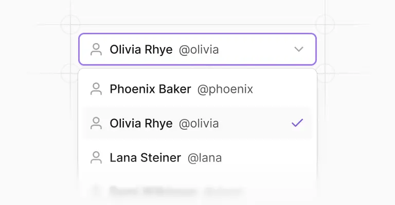
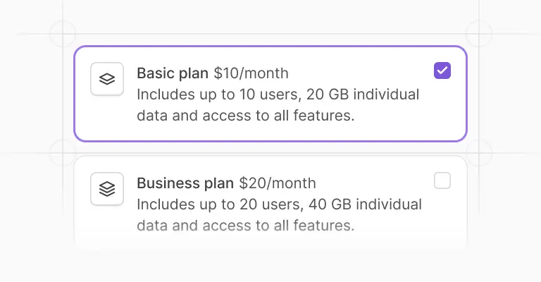

# 团队模式选择交互参考

本页记录「团队模式选择」的现象定位与优秀产品/设计系统的选择器范式，并记录本轮按 P0 建议实施的改动。P1/P2 仍为建议；上一轮六条改动的前后对照见 [界面优化前后对照](18-界面优化前后对照.md)。

## 现象与定位

复现路径：在 WSL 预览实例选择工作区 `project` 后重新回到会话，输入框上方只显示「标准模式」按钮，团队选择以一个灰色 ``「团队模式 · 五子棋交付团队」出现在旁边。实测 DOM 结果：

| 状态 | 预设按钮 | 团队按钮 | suffix 文本 | 会话页头团队入口 |
|---|---|---|---|---|
| 未选工作区 | 无 | 无 | 无 | 无 |
| 选择工作区 `project` 后 | 「标准模式」 | 无 | 「团队模式 · 五子棋交付团队」 | 无 |

**数据没有丢**：`TeamPickerController.load()` 从 `projectTeamContext.current(sessionId)` 读取按会话持久化的偏好（`team-picker.ts:40-66`），suffix 有值说明团队名与版本已恢复。问题是状态表达，不是持久化。

四处具体原因：

1. **主控件显示的是预设，不是团队选择**。`ui-agent-preset/src/client/AgentPresetSeat.tsx:166-209` 的菜单显示当前工具预设并给选中项打勾；团队模式是 `conversation.hero.agentPreset.options` 槽位注入的可叠加入口（`team-picker.ts:152-154`），不改变预设。因此「标准模式」永远带勾选，与用户记忆中的「我选了团队模式」冲突。
2. **团队选择没有"当前值"控件**。`TeamPicker.tsx:77-82` 的 suffix 是一个最多 180px、会省略截断的纯文本 ``，不可点击、无下拉箭头、无 `title`；改选只能重新打开预设菜单。
3. **菜单项没有选中态**。`TeamPicker.tsx:32-43` 的 `TeamPickerOption` 是 `MenuItemButton`，无论是否已选都显示同一行「团队模式」，没有勾选或 `aria-*` 选中标记。
4. **已开始会话的页头入口在空白会话不渲染**。`TeamPicker.tsx:61-68` 的 `hidden` 判断把 `summary === undefined || summary.blank || origin === 'subagent'` 的会话排除，`06-实施记录.md:536` 也把「已开始会话入口的真实页面专项检查」列为待补齐。从工作区找回会话时页头因此没有团队入口。

## 参考来源

沙箱网络限制使第三方页面截图无法留档（`ERR_CONNECTION_RESET`），下表区分一手页面与检索摘要，不把摘要当成页面原文。

| 来源 | 类型 | 可借鉴要点 | 证据 |
|---|---|---|---|
| [Radix Select](https://www.radix-ui.com/primitives/docs/components/select) | 组件规范 | `Select.Value` 在 trigger 上反映当前选中值；`ItemIndicator` 给选中项打勾；`data-state="checked"`；trigger 带 chevron；Space/Enter/方向键/Esc 键盘导航；分组与分隔符 | 一手页面 |
| [shadcn/ui Combobox](https://ui.shadcn.com/docs/components/base/combobox) | 组件规范 | 可搜索、Empty 空态、Clear Button、分组、Popup 由按钮触发、多选 chips | 一手页面 |
| [Untitled UI Select](https://www.untitledui.com/components/select) | 组件规范 | select 显示选中值而 dropdown menu 不显示；菜单项有 default/hover/disabled/**selected with check** 四态；**少于 5 个选项改用 radio group**；focus 与 selection 是两种状态；placeholder 写具体（「Select team member」）；avatar-leading 适合人员选择 | 一手页面 |
| [W3C ARIA APG Listbox](https://www.w3.org/WAI/ARIA/apg/patterns/listbox/) | 无障碍规范 | 单选 listbox 用 `aria-selected`；焦点与选中态分离；已有选中项时聚焦到该项；type-ahead；分组需 accessible name | 一手页面 |
| [NNGroup Dropdown Guidelines](https://www.nngroup.com/articles/drop-down-menus/) | 可用性指南 | 禁用项置灰保留而非移除（悬停说明原因）；菜单打开时保持标签可见；支持键盘输入；避免联动菜单（一个菜单的选项随另一个变化） | 一手页面 |
| [GitHub Assignees](https://docs.github.com/en/issues/tracking-your-work-with-issues/using-issues/assigning-issues-and-pull-requests-to-other-github-users) | 产品交互 | 输入用户名即时过滤、点击加入、右侧栏、可多选 | 检索摘要 |
| [AI UX Playground · Model Selection UI](https://aiuxplayground.com/pattern/model-selection-ui) | AI 产品模式库 | 选择放在 composer bar；**bar 用平实语言显示当前选择**；每个选项配一行"做什么"的说明；选中后确认文案在下次发送前更新；证据表列 ChatGPT / Claude / Perplexity / Gemini | 检索摘要（页面抓取失败） |
| [assistant-ui Model Selector](https://www.assistant-ui.com/elements/model-selector) | 开源组件 | 每行 `aria-pressed` toggle；**勾选列固定宽度，选中变化不导致行位移**；按 model family 分组；每行带上下文长度、价格、能力 chips | 检索摘要（页面抓取失败） |
| ChatGPT / Claude / Cursor / Perplexity / Gemini | AI 产品 | ChatGPT 把模型名换成 outcome-oriented 的 Instant / Thinking / Pro 宽选项并把模型与推理控制放在 composer 下方（[官方 Models 文档](https://learn.chatgpt.com/docs/models)）；Claude 把模型与 effort 放在 composer 上；Cursor 选中模型旁有 check mark、3.0 按 model family 分组并 hover 展开推理等级；Perplexity/Gemini 用平实语言标注档位 | 检索摘要（官方页抓取失败） |

原创[建议态示意图](ui-review-20261119/reference/proposal-composer.png)按上述范式绘制；当前界面对照见[团队选择弹窗并排图](ui-review-20261119/compare/06-team-picker.jpeg)。

## 官方配图留档

以下配图经公开页面下载并转为 PNG，仅作本仓库内部设计评审参考，版权归各自所有者，不对外分发。

| 配图 | 来源 | 对应关系 |
|---|---|---|
| [人员选择器](ui-review-20261119/reference/untitledui-select.png) | [Untitled UI Select](https://www.untitledui.com/components/select) | trigger 显示当前选中值 + chevron，展开列表选中项带勾选 |
| [单选卡片](ui-review-20261119/reference/untitledui-radio-groups.png) | [Untitled UI Radio groups](https://www.untitledui.com/components/radio-groups) | 少于 5 个选项直接铺开，选中项高亮，每项一行说明 |
| [Dropdowns](ui-review-20261119/reference/untitledui-dropdowns.png) | [Untitled UI Dropdowns](https://www.untitledui.com/components/dropdowns) | select（选值）与 menu（执行动作）的形态差异 |
| [Multi-select](ui-review-20261119/reference/untitledui-multi-select.png) | [Untitled UI Multi-select](https://www.untitledui.com/components/multi-select) | 多值 chips 与可移除标签 |
| [属性选择示例](ui-review-20261119/reference/nngroup-attribute-selection.png) | [NNGroup Dropdown Guidelines](https://www.nngroup.com/articles/drop-down-menus/) | 属性选择型下拉的取值方式 |
| [禁用项示例](ui-review-20261119/reference/nngroup-disabled-options.png) | [NNGroup Dropdown Guidelines](https://www.nngroup.com/articles/drop-down-menus/) | 不可用项置灰保留而非移除 |

## 提炼出的范式

下表「当前差距」描述的是本轮改动前的界面。

| 范式 | 依据 | 当前差距 |
|---|---|---|
| 当前选择必须显示在主控件上，而不是旁注 | Radix `Select.Value`、Untitled UI、AI UX Playground | 主控件是「标准模式」，团队选择只是灰色截断 span |
| 选中项要有勾选，且勾选列不随选中态变化而让行位移 | Radix `ItemIndicator`、Untitled UI selected、assistant-ui、Cursor | 菜单项与团队项都没有选中标记 |
| 少于 5 个选项直接铺开为单选，不藏在"列表 + 使用按钮"里 | Untitled UI radio group 建议、NNGroup | 弹窗里只有 1 个团队，却用列表 + 「使用 团队」 |
| select（选值）与 menu（执行动作）分开 | Untitled UI、NNGroup | 「使用 团队」「配置」「清除」「刷新」混在同一个弹窗里抢占层级 |
| 选项配一行"做什么"的说明，标签用结果导向的平实语言 | AI UX Playground、ChatGPT Instant/Thinking/Pro | 「团队模式 · 团队名」只写了对象，没写它带来什么（规划默认值、看板启用） |
| 选中后即时确认，下一次发送前可见 | AI UX Playground、ChatGPT | 选完只关闭弹窗，`saving` 期间仅禁用按钮，无确认文案 |
| 禁用项保留并说明原因，菜单打开时标签仍在 | NNGroup、W3C APG | 现状「未选工作区时禁用并说明」符合这一条，应保留 |
| 焦点与选中态分离，键盘可达，选中态用 `aria-selected` | W3C APG、Radix | 当前菜单项与 suffix 都没有选中语义，`aria-expanded`/焦点未复核 |

## 改进建议

P0 四条已在 `ui-review-polish` 分支实施，实施结果见「本轮实施」；P1/P2 仍待后续。

**P0：让当前选择可见且可信**

1. 把团队选择做成 composer bar 上的**独立 chip 主控件**：显示「团队 · {团队名}」+ 状态点 + chevron，点击直接打开团队选择；未选时显示「选择团队」。它与「标准模式」并列，不再把「团队模式」放进互斥预设菜单，保持 `02-产品设计与交互.md:21` 的非互斥语义。
2. 团队选择列表用**单选行 + 固定宽度勾选列**：每行团队名 + 一行成员/模型摘要，选中项打勾并 `aria-selected="true"`；再加「不使用团队」一行作为显式清除。
3. 修会话恢复可见性：`TeamPickerHeader` 的 `hidden` 判断复核 `blank`/`undefined` 会话，保证从工作区找回的会话页头也能看到团队入口；`load()` 完成后主控件才显示已恢复的团队名。
4. 给主控件与菜单项补选中语义（`aria-expanded`、`aria-selected`、键盘导航），并保留禁用态说明。

**P1：动作分层与即时反馈**

5. 主 CTA 改为底部实心 primary 按钮（「使用此团队」）；「管理员工与团队」「清除选择」「刷新」收为文本链接或图标，配置动作可复用工作台右上已有入口。
6. 选中后立即更新主控件文案与看板状态，必要时给一句确认（例如「已设为当前会话的规划默认值」），不要只关闭弹窗。
7. 组合标签截断改为完整名 + `title`/`aria-label`，或拆成「团队」标签 + 独立团队名 chip 两段，各自可点击。

**P2：规模与边界**

8. 团队数量增长后补搜索、空态与分组（shadcn Combobox、GitHub Assignees）；成员行继续用单行省略号。
9. 深色主题、八语种排版、390px 窄屏与键盘焦点按 [17 号文档](17-界面走查与优化建议.md) 的未覆盖项一并回验。

建议态示意：[proposal-composer.png](ui-review-20261119/reference/proposal-composer.png)。

## 本轮实施

按 P0 建议改动 `packages/experimental/client-ui-meeting-room/src/client/TeamPicker.tsx`、`TeamPicker.module.css`、`locales.ts`（新增 `team-mode.select` / `team-mode.no-team` / `team-mode.no-team-hint` 三个键 × 8 语）与 `tests/team-picker.client.spec.tsx`：

1. composer bar 上的团队控件从灰色截断 `` 改为可点击 `Button`，显示当前团队名 + chevron + `aria-expanded`，`title` 补全完整名；未选时显示「选择团队」。
2. 弹窗内容改为 `role="radiogroup"` 单选行：每行团队名 + 一行成员摘要，选中项有固定宽度勾选列与 `aria-checked`；新增「不使用团队」行作为显式清除；底部为实心 primary 主 CTA，刷新与配置收为次要动作。
3. 预设菜单里的「团队模式」项保留（不改非互斥语义），但按反馈恢复为纯「团队模式」四字 + 说明行：不带团队名称、不带选中勾选，避免与「标准模式」的勾选在一个互斥菜单里形成双勾选误读。
4. composer bar 的团队名 chip 改为**仅在已选团队时显示**；未选时整块不出现、按默认工具预设运行，开启入口仍由菜单里的「团队模式」项承担。
5. 主 CTA 允许重复应用，保留看板启用失败后的重试路径；`TeamPickerController` 与 `projectTeamContext` 持久化格式未改。

前后对照：[并排对比图](ui-review-20261119/round2/compare-picker.jpeg)（before 为上一轮界面）、[改动后弹窗](ui-review-20261119/round2/02-picker.jpeg)、[改动后 composer bar](ui-review-20261119/round2/01-composer.jpeg)。按反馈修正后的下拉菜单见 [02-mode-menu.jpeg](ui-review-20261119/round3/02-mode-menu.jpeg)（只有「标准模式」一个勾选，「团队模式」不带团队名）与 [01-composer.jpeg](ui-review-20261119/round3/01-composer.jpeg)。

验证：聚焦测试 6 文件 27 项通过（含「未选团队时 composer chip 不显示」）、`pnpm exec oxlint` 通过、`verify-client-ui-i18n` 通过、`pnpm run build` 10 项 gate 通过、颜色 token gate 4 项通过；WSL 预览副本 `build:artifacts` 8 项通过并按原 profile 重启，截图确认下拉菜单只剩「标准模式」一个勾选、菜单里的「团队模式」不带团队名称，弹窗两个 `radio` 且选中态为 `aria-checked="true"`。

## 待决策

- **信息架构**：本轮按「可叠加的独立控件」实施，不改 `02:21` 的非互斥语义；预设菜单里的「团队模式」项保留为第二入口。若要改成第五个互斥预设，需另立任务并同步 Host 侧选择语义与 `06` 的验收记录。
- **是否把团队名写进主控件**：写进去能解决状态可见性，但会让 composer bar 更长，需按 `dsh-responsive-ui` 复核窄屏与长团队名。
- **是否保留会话页头入口**：主控件已可见时，页头入口是否还需要，涉及 `conversation.session.header.actions` 槽位的去留。
- **范围边界**：以上改动只涉及 Client UI 偏好展示，不改 model-visible prompt 与 `projectTeamContext` 持久化格式；若要把「团队模式」变成真正的预设，会触及 Host 侧选择语义与 `06` 的验收记录，需要另立任务。
- 按 `07-迭代计划与评审.md:77` 与 `dsh-client-ui-ux` skill，用户可感知的界面改动落地前需设计师/产品评审。

## 未验证与限制

- AI 产品（ChatGPT / Cursor / Claude）的真实界面截图未能留档：headless 浏览器访问外网被 `ERR_CONNECTION_RESET` 重置，官方页面只提供标题卡片式的 og:image。已留档的是可访问的设计系统组件图与 NNGroup 指南配图，来源见「官方配图留档」；示意图为原创绘制、非任何产品截图。
- 状态恢复只在「新会话 + 选择工作区 `project`」路径实测（本轮重启预览后主控件仍显示已恢复的团队名）；已开始会话、跨进程重启、子会话与多工作区切换未复核（`06-实施记录.md:536` 同样列为待补齐）。
- 本轮未复核深色主题、八语种排版、390px 窄屏与键盘焦点；失败/受阻态仍无真实数据。
- 「选了团队模式后从工作区找回」目前定位为状态表达问题，尚未排查 `TeamPickerController` 在并发读写、取消与 `choose()` 遇 `reading` 时静默返回的交互边界。
