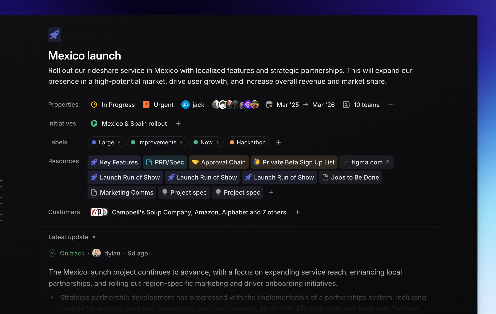
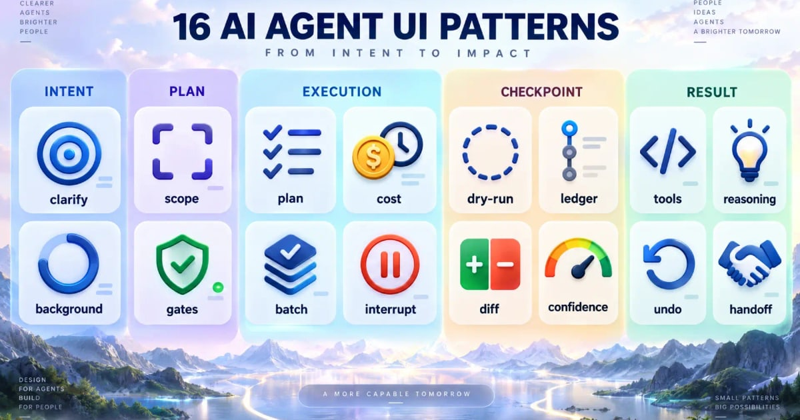
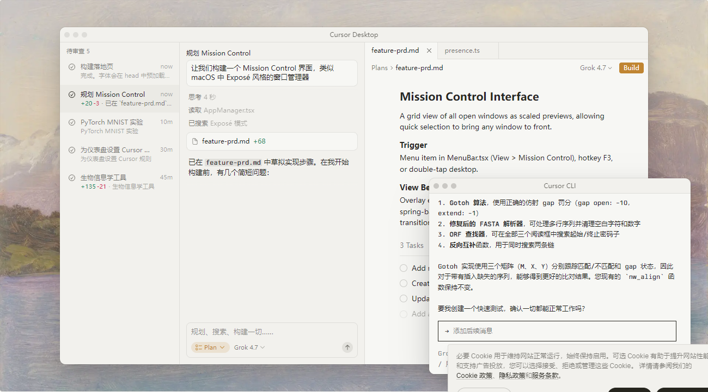

# 项目工作台设计参考

本页为「项目工作台看不到重点」的**讨论素材**：留存同类产品与组件范式配图，提炼可借鉴的信息层级，并列出可选的修改方向。**本页内容均未实施**，当前界面见 [界面优化前后对照](18-界面优化前后对照.md)。

参考方向已收敛到团队/任务看板类产品，具体规范与调整建议见 [任务看板设计参考与调整建议](21-任务看板设计参考与调整建议.md)；本页保留为泛化参考。

## 现状与问题

当前工作台（[改动后首屏](ui-review-20261119/after/01-workbench.jpeg)、[执行区](ui-review-20261119/after/03-execution.jpeg)）把「数字员工与团队」「项目计划与确认」「执行记录」三大块等权重纵向平铺：员工卡片逐条列出英文职责原文，计划块含目标句、版本、绝对路径、任务指令与逐项 AC 条款，执行区再列一次任务与验收报告。状态信息（已确认 / 已完成 / 任务已产出 / Agent 检查通过）混在正文里，缺少一句话的「现在到哪了、有没有卡住、要我做什么」。上一轮已做状态 chip、执行区去重、路径 chip 与限宽，但这些是局部可读性修复，**没有改变首屏的信息权重**。

用户回来时需要在几秒内回答三个问题：做到哪了、有没有待处理、下一步做什么。当前首屏把这三个答案埋在长文本里。对照 [Cursor Desktop 任务列表](ui-review-20261119/workbench-refs/cursor-desktop-agents.png)：它把「待审查 5」按行列出，每行一个状态、时间与一句副标题，主区同时给出当前 Plan 与文件，一屏回答同样的问题。

## 参考图留档

以下配图经公开页面下载并转为 PNG，仅作本仓库内部设计评审参考，版权归各自所有者，不对外分发。部分为官方品牌 og 图（非界面截图），已单独标注。

| 配图 | 来源 | 可借鉴点 |
|---|---|---|
| [Linear 项目概览](ui-review-20261119/workbench-refs/linear-projects-overview.png) | [Linear · Projects 文档](https://linear.app/docs/projects) | 大标题 + 一句目标；`Properties` 一行压入状态 / 优先级 / 负责人 / 起止时间 / 团队数；Initiatives / Labels / Resources / Customers 分区；`Latest update` 卡片带 On track 状态、作者与时间 |
| [Linear 项目属性编辑](ui-review-20261119/workbench-refs/linear-projects-progress.png) | [Linear · Projects 文档](https://linear.app/docs/projects) | 属性以紧凑行 + 状态点 / 标签呈现，编辑在浮层完成，不把表单铺进主区 |
| [AI Agent UI 16 模式](ui-review-20261119/workbench-refs/setproduct-ai-agent-patterns.png) | [Setproduct](https://www.setproduct.com/blog/ai-agent-ui-design-patterns) | Intent / Plan / Execution / Checkpoint / Result 五段框架；任务 ledger、失败步骤保留并标注、成本与中断、confidence 与 handoff |
| [Tables](ui-review-20261119/workbench-refs/untitledui-tables.png) | [Untitled UI · Tables](https://www.untitledui.com/components/tables) | 明细用紧凑表格，状态列用 chip，行内动作收在末尾 |
| [Sidebar navigations](ui-review-20261119/workbench-refs/untitledui-sidebar.png) | [Untitled UI · Sidebar navigations](https://www.untitledui.com/components/sidebar-navigations) | 次要对象放侧栏，主区只留当前焦点 |
| [Progress indicators](ui-review-20261119/workbench-refs/untitledui-progress-indicators.png) | [Untitled UI · Progress indicators](https://www.untitledui.com/components/progress-indicators) | 进度用条 / 环表达，不用纯文字百分比 |
| [Progress steps](ui-review-20261119/workbench-refs/untitledui-progress-steps.png) | [Untitled UI · Progress steps](https://www.untitledui.com/components/progress-steps) | 阶段条：已完成 / 当前 / 未开始，一眼定位到哪一段 |
| [Metrics](ui-review-20261119/workbench-refs/untitledui-metrics.png) | [Untitled UI · Metrics](https://www.untitledui.com/components/metrics) | 关键数字做成指标卡，标题小、数值大 |
| [Activity feeds](ui-review-20261119/workbench-refs/untitledui-activity-feeds.png) | [Untitled UI · Activity feeds](https://www.untitledui.com/components/activity-feeds) | 最近动态按时间倒序，每条一行带状态点 |
| [Devin og 图](ui-review-20261119/workbench-refs/devin-og.png) | [Cognition / Devin](https://cognition.ai) | 官方品牌图，非界面截图；仅作产品定位参考 |
| [Manus og 图](ui-review-20261119/workbench-refs/manus-og.png) | [Manus](https://manus.im) | 官方品牌图，非界面截图；仅作产品定位参考 |
| [Cursor Desktop 任务列表](ui-review-20261119/workbench-refs/cursor-desktop-agents.png) | [Cursor 首页](https://cursor.com) | 「待审查 5」分组列表，每行状态 + 时间 + 一句副标题；中间 Plan/执行详情、右侧文件，一屏回答「有哪些任务、当前在做什么」 |
| [Cursor Diff 审查](ui-review-20261119/workbench-refs/cursor-diff-review.png) | [Cursor 首页](https://cursor.com) | 变更审查以勾选与状态标签表达，不贴长日志 |
| [Cursor 任务审查](ui-review-20261119/workbench-refs/cursor-task-review.png) | [Cursor 首页](https://cursor.com) | 任务意见与待确认项按条列出，失败项保留可见 |
| [Cursor 状态列表](ui-review-20261119/workbench-refs/cursor-status-list.png) | [Cursor 首页](https://cursor.com) | 多个条目各带彩色状态图标，一眼扫读 |
| [Cursor New agents](ui-review-20261119/workbench-refs/cursor-new-agents.png) | [Cursor 首页](https://cursor.com) | 新建 agent 时把可选类型收进一个列表，主区保持干净 |
| [六阶段框架](ui-review-20261119/workbench-refs/setproduct-inarticle-1.png) | [Setproduct 文章](https://www.setproduct.com/blog/ai-agent-ui-design-patterns) | Intent / Plan / Execution / Checkpoint / Result / Audit 六阶段，比封面五段多了审计 |
| [状态 UI 示意](ui-review-20261119/workbench-refs/setproduct-inarticle-2.png) | [Setproduct 文章](https://www.setproduct.com/blog/ai-agent-ui-design-patterns) | 任务清单、进度条、成功/失败、diff、时间线六类状态呈现 |

检索摘要另给出可对照的产品行为：Claude Code / Cursor 把任务列表随完成状态更新，Cursor background agents 在侧栏列出每个 run 的状态，Manus 在任务旁展示步骤列表，GitHub Copilot coding agent 把会话日志写进 PR 时间线；这些强调「一行一个状态」而不是大段原文（[Setproduct](https://www.setproduct.com/blog/ai-agent-ui-design-patterns)、[Cursor Background Agents 指南](https://cursor.com/docs/background-agent)）。

## 提炼出的范式

| 范式 | 依据 | 当前差距 |
|---|---|---|
| 标题下用一行属性条承载全部关键事实（状态 / 负责人 / 时间 / 版本） | Linear 项目概览 | 版本、确认状态、团队名散落在计划块正文里 |
| 首屏给「一句话进展 + 待我处理」，长文按分区折叠 | Linear `Latest update`、Setproduct ledger | 首屏被员工职责、任务指令、AC 条款占满 |
| 阶段进度用阶段条 / 指标卡，不用纯文字 | Progress steps、Metrics、Progress indicators | 「已确认 / 已完成 / 通过」虽有状态点，但没有阶段位置与总量 |
| 明细用紧凑表格或列表，行内状态用 chip | Tables、Activity feeds、Cursor/Claude Code 任务列表 | 任务与验收仍以段落 + 折叠块呈现 |
| 任务按「待审 / 进行中」分组，一行一状态 + 一行副标题 + 时间 | Cursor Desktop 任务列表 | 现有任务与验收无分组、无时间，长文优先 |
| 次要对象（名册 / 团队 / 历史）放侧栏或独立分区 | Sidebar navigations | 名册卡片与计划、执行等权重占首屏 |
| 失败步骤保留并标注，不只显示成功 | Setproduct「keep failed steps in place, marked」 | 本轮数据全是成功态，失败/返工态未设计 |
| 五段框架：意图 → 计划 → 执行 → 检查点 → 结果 | Setproduct 16 模式 | 现有分区是「谁来做 / 做什么 / 做到哪 / 交了什么」，缺少显式的检查点与结果摘要 |

## 可选修改方向

以下三个方向**只作讨论**，不实施；可组合，也可只取其中一层。

**方向 A：概览优先（改动最小、推荐先试）**

首屏只保留四块：一行状态条（目标 + 计划版本 + 确认状态 + 当前阶段 + 待处理数）、3–4 个指标卡（任务完成数 / 验收通过数 / 返工次数 / 最近更新）、「待我处理」列表、最近动态时间线。员工名册、计划全文、逐项 AC、验收报告原文全部移入下方分区或折叠，默认收起。代价：需要新增一个概览组件与状态汇总逻辑；好处是保留「一页找全」的前提下把重点前置。

**方向 B：阶段时间线优先**

按「需求提出 → 团队模式 → 计划确认 → 派工执行 → 独立验收 → 交接与成果」做竖向阶段条，每步一张摘要卡（状态 chip + 一句结论 + 关键产物 chip），原文折叠在卡内。与 [02-产品设计与交互.md](02-产品设计与交互.md) 的运行时间线意图一致。代价：改动最大，需要把现有三大块拆解重排；好处是与产品心智一致。

**方向 C：双栏（主区任务 + 右侧属性）**

左栏是任务/执行列表（一行一状态），右栏固定放项目属性、成果与证据（复用 [08-UI出图需求.md](08-UI出图需求.md) 的 320px 右栏栅格）。代价：窄屏需要重排，且 `ProjectPage.module.css` 目前是单列；好处是长页滚动时关键事实始终可见。

## 待讨论的决定

- 首屏第一焦点是**「项目现在到哪了」**（进度/阶段）还是**「有没有等我处理的事」**（待办/审批）？两者会导向不同的顶部组件。
- 完整的任务指令、AC 条款、验收报告原文要保留到哪一层：默认折叠、放进 Tab、还是移到独立「详情」页？上一轮 P0-2 已把执行区重复指令删掉，但未触及计划块的原文长度。
- 是否引入分区导航或 Tab？这会削弱 17 号文档里「关键事实齐全、无需跳转」这条被判定为优点的性质，需要权衡。
- 指标卡与阶段条是否用 DSH 现有 `ui-primitives` 组件与 `--dsw-alias-*` token，避免引入新字面色值与新组件库。
- 失败 / 受阻 / 返工 / 空 / 加载态怎么呈现？当前走查数据全是成功态，这一类状态恰恰是「看不到重点」时最需要被看见的。

## 团队模式联动：不是 bug，但语义需要定

选团队后自动出现「智能体团队协作 开启」是**有意的联动**：`team-picker.ts:102` 在 `choose(team)` 成功后调用 `agentTeams.setEnabled(sessionId, true, …)`；`06-实施记录.md:530` 明确记录「选择…后启用既有 Team 看板；清除只移除规划默认值，保留看板和任务」，`06:534` 也把「保存选择及启用看板」列为已验证项。清除团队不会关看板，看板启用失败会保留选择并提供刷新/重试。

张力在于弹窗文案 `team-mode.hint` 首句是「选择团队只设定规划默认值，不批准计划或启动员工」，而模型下拉里出现「智能体团队协作 开启」会让用户以为有东西被启动了。可选处理：

1. **保持联动，改文案**：把 hint 改成「选择团队会设为规划默认值并启用共享任务看板；不批准计划或启动员工」，让行为与说明一致。
2. **改为不自动开启**：只写规划默认值，看板由用户在模型菜单里自行开启；需要同步改 `choose()`、`06` 的验收记录与相关测试，属于行为变更。
3. **显式告知**：在选择弹窗里加一行「将同时开启智能体团队协作」，用户确认后再写；成本介于前两者之间。

## 未验证与限制

- 第三方页面截图分两种来源：组件/文档配图经 `curl --ssl-no-revoke` 下载；Cursor Desktop、Cursor 审查流程、Setproduct 正文配图与 Linear 首页等**真实产品页面**经本机 `127.0.0.1:7890` 代理 + headless Chromium 渲染与元素截图抓取。Untitled UI 页面在该代理下仍被重置，故其组件图走 `curl` 下载。Devin / Manus 仍只有官方 og 品牌图，没有登录后的真实工作台界面。
- 配图版权归各自所有者，仅作内部评审参考，不对外分发。
- 「看不到重点」目前是基于 [17 号走查](17-界面走查与优化建议.md) 与本轮截图的判断，未做用户测试或眼动/首屏热力验证；三个修改方向也未做视觉稿。
