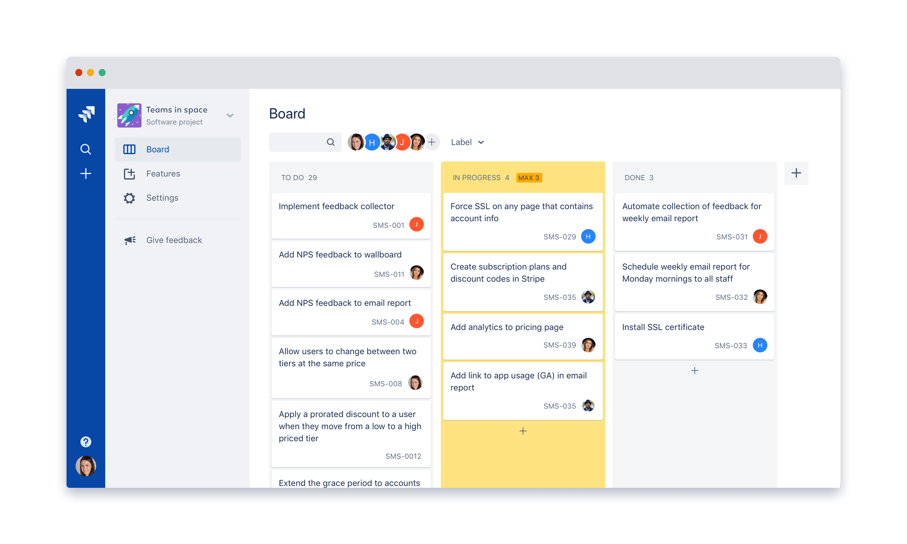
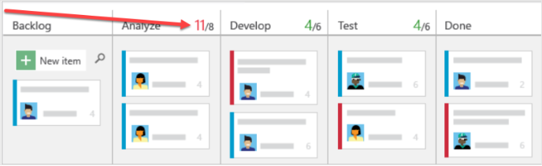

# 任务看板设计参考与调整建议

本页把参考对象收敛到**出名的 web 团队/任务看板产品**：Jira Software、Azure Boards、Atlassian Kanban 指南、Linear、Notion 与 Cursor 的任务列表。按这些产品实际遵循的看板规范，给出项目工作台的具体调整建议。P0 三件套已落地，结果见 [项目工作台看板改造对照](22-项目工作台看板改造对照.md)；上一轮泛化参考见 [项目工作台设计参考](20-项目工作台设计参考.md)。

## 参考图留档

配图经本机 `127.0.0.1:7890` 代理 + headless Chromium 渲染或元素截图抓取，仅作本仓库内部设计评审参考，版权归各自所有者，不对外分发。

| 产品 | 配图 | 官方来源 | 可借鉴点 |
|---|---|---|---|
| Jira Software | [Jira 看板](ui-review-20261119/board-refs/jira-kanban-board.png) | [Atlassian Kanban 指南](https://www.atlassian.com/agile/kanban/boards) | `TO DO 29` / `IN PROGRESS 4 MAX 3` / `DONE 3` 三列；列头带数量与 WIP 上限；卡片只有标题、issue key（SMS-001）、负责人头像；`IN PROGRESS` 用整列底色标出超限 |
| Jira Software | [Jira 界面](ui-review-20261119/board-refs/jira-ui-overview.png) | [Jira 产品页](https://www.atlassian.com/software/jira) | 顶部导航 + 左侧栏 + 主区看板；卡片带状态标签与成员头像 |
| Jira / Atlassian | [多视图面板](ui-review-20261119/board-refs/atlassian-jira-views.png) | [Atlassian Kanban 指南](https://www.atlassian.com/agile/kanban/boards) | 看板、列表、图表等视图并列切换 |
| Azure Boards | [Azure 看板](ui-review-20261119/board-refs/azure-boards-kanban.png) | [Microsoft Learn · Kanban basics](https://learn.microsoft.com/en-us/azure/devops/boards/boards/kanban-basics?view=azure-devops) | `New` / `Active 5/5` / `Resolved` 列；列头 WIP 计数；卡片含 Story Points、彩色标签（Phone / Service）、负责人 |
| Azure Boards | [WIP 分列](ui-review-20261119/board-refs/azure-boards-wip-columns.png) | 同上 | `Backlog → Development 4/4 → Test 4/4 → Done`，每列带 WIP 数字，卡片按列归组 |
| Azure Boards | [Backlog 看板](ui-review-20261119/board-refs/azure-boards-backlog-board.png) | 同上 | `+ New work item` 在各列顶部，卡片可就地新建 |
| Azure Boards | [团队切换](ui-review-20261119/board-refs/azure-boards-team-switcher.png) | 同上 | 团队/看板切换收在顶部下拉，不占主区 |
| Atlassian 指南 | [Kanban 列与卡片](ui-review-20261119/board-refs/atlassian-kanban-columns.png) | [Atlassian Kanban 指南](https://www.atlassian.com/agile/kanban/boards) | 列 = 状态、卡片 = 工作项、跨列移动 = 状态推进的规范示意 |
| Atlassian 指南 | [WIP 限制](ui-review-20261119/board-refs/atlassian-wip-limits.png) | 同上 | 物理看板 `3` / `5` / `✓` 三列，WIP 上限是看板的一等元素 |
| Linear | [项目概览](ui-review-20261119/board-refs/linear-project-overview.png) | [Linear · Projects 文档](https://linear.app/docs/projects) | 标题 + 一句目标 + 一行 `Properties`（状态 / 优先级 / 负责人 / 时间 / 团队数）+ 分区 + `Latest update` |
| Linear | [Issue 列表](ui-review-20261119/board-refs/linear-issue-list.png) | [Linear](https://linear.app) | 紧凑行列表，状态图标 + 标题 + 负责人，密度高但可扫读 |
| Notion | [工作区](ui-review-20261119/board-refs/notion-workspace.png) | [Notion](https://www.notion.com/product) | 左侧导航 + 主区数据库视图；表格/看板作为同一数据的不同视图 |
| Cursor | [任务列表](ui-review-20261119/board-refs/cursor-task-list.png) | [Cursor](https://cursor.com) | 「待审查 5」分组，每行状态 + 时间 + 一句副标题；详情与文件在右侧 |

## 看板类产品的通用规范

1. **列 = 状态**。列头显示任务数与 WIP 上限：Jira 是 `TO DO 29` / `IN PROGRESS 4 MAX 3` / `DONE 3`，Azure 是 `Active 5/5`、`Development 4/4`、`Test 4/4`。数量与上限写在列头，用户不必逐卡数。
2. **卡片 = 一个任务，且卡片只放关键信息**：标识（issue key）、标题、负责人头像、状态/标签、关键数值（Story Points、附件/评论数）、时间。长描述、检查项、证据、历史都不进卡片。
3. **WIP 限制是一等元素**，超限要有视觉表达：Jira 给 `IN PROGRESS` 整列底色，Atlassian 指南用 `3` / `5` 数字约束在制量。
4. **分组/泳道**：按团队、负责人、优先级切分；Azure 把团队切换收在顶部下拉。
5. **拖放即改状态**，状态色语义固定，列与标签共用同一套颜色。
6. **卡片点击才进详情**：长文、逐项验收标准、证据路径、交接记录、历史都放在详情页或抽屉里。
7. **视图切换与筛选**：Board / List / Table / Timeline 是同一批数据的不同投影（Linear、Notion、Jira 多视图），不是另建一套数据。
8. **侧栏承载导航与次要对象**，主区只放当前看板；Notion、Linear、Azure 都如此。
9. **受阻与待处理优先可见**：分列本身就让「卡在哪一列、卡了多少」可见，失败项保留并标注，不隐藏。

## 当前工作台与规范的差距

| 规范 | 当前工作台 | 后果 |
|---|---|---|
| 列 = 状态 | 三大块（员工与团队 / 项目计划与确认 / 执行记录）等权重纵向分区 | 没有「各阶段有多少、卡在哪」的概览 |
| 卡片只放关键信息 | 任务指令、AC 条款、验收报告原文、交接记录直接平铺在主区 | 把「详情」放在了「卡片」的位置，重点被长文淹没 |
| 列头数量与 WIP | 只有散在正文里的状态 chip；返工上限写在一行文字里 | 无法一眼看出总量与超限 |
| 卡片进详情 | 全部内容一页展开，靠 `
` 折叠 | 折叠块仍占位，首屏长度失控 |
| 侧栏放次要对象 | 名册与团队卡片占首屏上半部 | 与任务/进度抢注意力 |
| 待处理优先 | 人工放行、验收未通过、返工混在区块里 | 用户回来不知道自己要做什么 |

上一轮做的状态 chip、执行区去重、路径 chip 与限宽是局部可读性修复，没有把信息组织方式改成看板。

## 调整建议

**P0-1 顶部项目属性条**

在页面标题下加一行 chip 属性条：目标（截断 + `title`）、计划版本、确认状态、当前团队、当前阶段、待处理数。参考 Linear `Properties`。数据全部来自现有 `catalog.plans` / `catalog.records`，无需新 Host 接口。文件：`ProjectPage.tsx` + `ProjectPage.module.css`，复用 `StatusChip`。

**P0-2 任务看板（核心）**

把「项目计划与确认」和「执行记录」合并为**按状态分列**的任务看板，列定义直接映射现有 `latest.state` 与 `teamTask.status`：

| 列 | 来源状态 | 列头 |
|---|---|---|
| 待开始 | `started` / `starting` / `draft` | 数量 |
| 进行中 | `running` / `reviewing` / `reworking` / `task-produced` | 数量 + `上限 = 已授权返工上限` |
| 待验收 | `awaiting-acceptance` / `awaiting-human` / `awaiting-review` / `awaiting-direction` | 数量，人工放行项标「待我处理」 |
| 已通过 | `acceptance-passed` / `completed` / `released` | 数量 |
| 受阻 | `acceptance-blocked` / `failed` / `blocked` / `interrupted` | 数量，列头用 error 语义色 |

每张任务卡只保留：任务名、负责员工、状态 chip、计划版本、一句结论/交接摘要、产物 chip（复用 `FileChip`）。卡片点击展开详情（抽屉或 `
`），详情里才放任务指令、AC 条款、验收报告原文、证据路径与哈希、交接记录。数据已齐，主要是 `ProjectPage.tsx` 的渲染重组；`StatusChip` / `FileChip` 可直接复用。

**P0-3 长文下沉**

主区不再出现任务指令原文、逐项 AC 条款、验收报告原文与长交接文本；这些统一进卡片详情。保留上一轮 P0-2 的「执行区去重」成果，但把去重后的摘要升级成卡片副标题。

**P1-1 待我处理置顶**

属性条下方单独一块「待我处理」：人工确认放行、验收未通过、返工、看板启用失败（现有 `boardFailed`）、未关联主会话的旧计划（现有 `plan.unlinked`）。每项一句话 + 直达动作按钮，参考 Azure 把 `New`/`Active` 分列后一眼可见待办。

**P1-2 名册与团队移出首屏**

「数字员工与团队」移到侧栏或独立 Tab/分区，默认收起。工作台右上已有「配置员工 / 配置团队」直达入口，不丢功能。参考 Notion / Linear 的侧栏承载次要对象。

**P1-3 状态色与 chip 统一**

列头、卡片状态、待处理项统一用 `--dsw-alias-state-*` 语义 token 与 `StatusChip`；受阻列用 error 色、待验收用 warning 色、已通过用 done 色。不引入新字面色值。

**P2 视图切换、筛选与拖放**

先看板视图落地，再评估 List / Timeline 切换（同一批 `catalog` 数据投影）。**拖放改状态不建议第一步做**：它会引入 Host 侧状态写入、并发与权限校验，属于行为变更，需要单独设计与测试。

## 改造前后信息结构对照

| | 改造前 | 改造后 |
|---|---|---|
| 首屏 | 名册卡片（英文职责）→ 计划块（目标+版本+路径+任务指令+AC）→ 执行区（重复指令+报告） | 属性条 → 待我处理 → 五列任务看板（卡片只含关键信息） |
| 状态 | 散在正文里的 chip | 列头数量/WIP + 卡片状态 chip + 受阻列语义色 |
| 长文 | 主区平铺 + 折叠块 | 卡片详情 / 抽屉，按需展开 |
| 名册 | 占首屏上半部 | 侧栏或独立分区，默认收起 |
| 用户动作 | 在长文里找按钮 | 「待我处理」直达 + 卡片进详情 |

## 已定事项

- 列语义取**执行状态**（待开始/进行中/待验收/已通过/受阻），直接映射 `latest.state`，不引入第二套流程阶段。
- 不新增列级 WIP 配置：现有数据只有返工上限，它留在「待我处理」的返工条目里，列头只显示数量。
- 接受「详情多点一次」：长文收进看板下方的整幅详情面板，换取首屏可扫读。
- 详情用页面内展开面板，不用抽屉或弹窗；380px 的弹窗放不下任务指令与报告原文。
- 拖放改状态不纳入首版，状态推进仍通过主助手。
- 空列显示「暂无任务」；受阻、返工、待我处理由「待我处理」块与状态色表达，当前预览数据没有这些状态。

## 来源与限制

- 截图分两种来源：Jira / Azure Boards / Atlassian / Linear / Notion / Cursor 的真实页面与文档配图经本机 `127.0.0.1:7890` 代理 + headless Chromium 渲染或元素截图抓取；部分规范示意来自 Atlassian Kanban 指南的公开配图。
- Trello、Monday.com、GitHub Projects 的页面在该代理下加载失败或未产出可用大图，本页未收录其截图；它们的设计仍属于同一类看板规范，但不作为本页的图片证据。
- 未登录产品内部，抓到的是官方公开页面与文档中的界面图；不含真实用户数据。
- 配图版权归各自所有者，仅作内部评审参考，不对外分发。
- 建议基于 [17 号走查](17-界面走查与优化建议.md)、[18 号对照](18-界面优化前后对照.md) 与现有 `ProjectPage.tsx` 数据结构推导，未做用户测试或视觉稿。
