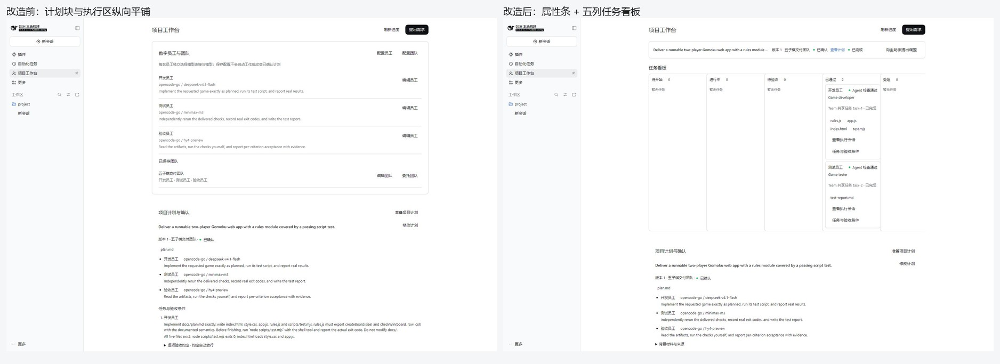
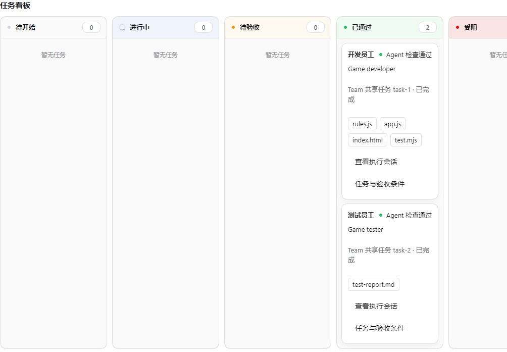

# 项目工作台看板改造对照

本页记录把项目工作台从「纵向平铺三大块」改为「属性条 + 五列任务看板 + 详情面板」的落地结果、前后对照与验收。方案来源见 [任务看板设计参考与调整建议](21-任务看板设计参考与调整建议.md)，本轮实施其 P0 三件套（属性条、任务看板、长文下沉），不含拖放与视图切换。看板之后的材质与断点调整见 [工作台视觉层次调整](23-工作台视觉层次调整.md)。

## 范围

- 实施：P0-1 顶部属性条、P0-2 按执行状态分列的任务看板、P0-3 长文下沉到详情面板。
- 附带：名册从首屏移到看板与计划之后；空列显示「暂无任务」；列头数量改为计数徽标。
- 未做：拖放改状态、Board/List/Timeline 视图切换、列级 WIP 上限配置。

## 捕获条件

| 条件 | 取值 |
|---|---|
| 视口 | 1780 × 1210 CSS px |
| 主题 | 浅色 |
| 语言 | 中文 |
| 字号 | 14px |
| dpr | 1 |
| 数据 | 同一 `DSH_HOME` 下的五子棋项目（1 个计划、2 个任务、均验收通过） |
| 预览实例 | 同一 WSL 预览（3080），改造前后各重启一次以加载对应产物 |
| 场景重放 | 同一滚动位置与展开状态；改造后额外点开第一张任务的「任务与验收条件」 |

改造前的截图取上一轮（P0+P1 六条）完成后的界面，即 [界面优化前后对照](18-界面优化前后对照.md) 的 after。两轮之间只有客户端产物变化，数据与入口相同。

## 前后对照

| 场景 | 改造前 | 改造后 | 并排 | 看什么 |
|---|---|---|---|---|
| 工作台首屏 | [首屏](ui-review-20261119/after/01-workbench.jpeg) | [首屏](ui-review-20261119/round4/01-workbench-first-screen.jpeg) | [并排](ui-review-20261119/compare/07-workbench-board.jpeg) | 首屏由「名册 → 计划 → 执行」变为「属性条 → 任务看板」；名册移到下方；看板五列带数量与空列提示。 |
| 任务详情 | [执行区](ui-review-20261119/after/03-execution.jpeg) | [展开详情](ui-review-20261119/round4/03-detail-open.jpeg) | [并排](ui-review-20261119/compare/08-task-detail.jpeg) | 任务指令、验收条款、报告原文原本平铺在主区，现在只在点击「任务与验收条件」后于整幅面板展开。 |

## 逐项验收

| 项目 | 改造前 | 改造后 | 验收结果 |
|---|---|---|---|
| P0-1 属性条 | 无项目级概览，计划版本、团队、确认状态、当前阶段分散在正文 | 标题下一行：目标（截断 + `title`）、计划版本、团队、确认状态、当前阶段、指向计划的锚点、向主助手提出调整 | 已回验：首屏第二行即属性条，`查看计划` 跳转到 `plan-<id>`。 |
| P0-2 任务看板 | 「项目计划与确认」与「执行记录」两块纵向平铺，任务指令与报告混排 | 五列：待开始 / 进行中 / 待验收 / 已通过 / 受阻；列头带数量；每张卡片只有员工、状态 chip、角色、团队任务关联、产物 chip、`查看执行会话`、`任务与验收条件` | 已回验：2 个任务全部落在「已通过」，数量为 2；其余四列为空并显示「暂无任务」。 |
| P0-3 长文下沉 | 任务指令、AC 条款、验收报告原文、交接记录平铺在主区 | 点击卡片按钮后在看板下方整幅面板显示，面板宽度与看板一致 | 已回验：详情面板内可读任务指令、AC 条款与报告原文，卡片上不再出现长文。 |
| 名册位置 | 名册与团队卡片占首屏上半部 | 移到看板与计划之后 | 已回验：首屏不再出现「数字员工与团队」。 |
| 空列表达 | 无空列概念 | 空列显示「暂无任务」，数量为 0 | 已回验：待开始 / 进行中 / 待验收 / 受阻四列均显示提示。 |

## 行为保留

看板重组没有削掉原有信息，以下内容仍可从界面到达：

- 全部验收报告代次：同一评审会话的重复报告去重保留最新一份，不同代次（例如首轮失败与返工后复核）并列保留。
- `teamLink` 的 `disabled` 与 `unavailable` 提示：显示在看板标题下。
- 计划级评审约定：放行方式、验收员工、逐条 AC 的方法/预期/证据、下游输入、返工上限与产物路径，位于详情面板内。
- 逐条交接记录：按任务归集在详情面板。
- 人工放行、待验收、继续执行、返工、未关联主会话的旧计划：集中在「待我处理」，看板数据中暂无这些状态时整块不渲染。
- 任务的团队共享任务关联与 `查看执行会话`：保留在卡片上。

## 检查记录

| 检查 | 结果 |
|---|---|
| `vitest run packages/experimental/client-ui-meeting-room/tests` | 27/27 通过 |
| `oxlint`（`ProjectPage.tsx`、`locales.ts`、相关用例） | 通过 |
| `verify-client-ui-i18n` | 1378 个 Client UI 源文件通过 |
| `build:artifacts`（Windows 与 WSL 各一次） | 8 gates 通过 |
| `verify-md-links` | 2640 个文件通过，相对链接与片段全部可解析 |
| `test:docs` | 21 gates 通过 |

用例调整了一处：报告原文现在位于详情面板，用例先点击「任务与验收条件」再断言两代报告文本；`awaiting-direction` 因属性条与任务卡同时显示阶段文案，改为断言至少出现一次。

## 已知不足

- 预览数据只有成功态，受阻、返工、待我处理三种状态没有真实截图；这些分支由单元用例覆盖，但没有视觉证据。
- 列宽固定 200px 起，五列在 1100px 内容宽度内不横向滚动；更窄的窗口会横向滚动，未单独截窄屏。
- 计划块仍在看板下方完整展示员工快照，与名册有内容重叠；下一步可折叠。
- 看板只读，状态推进仍通过主助手；拖放不在本轮范围。
