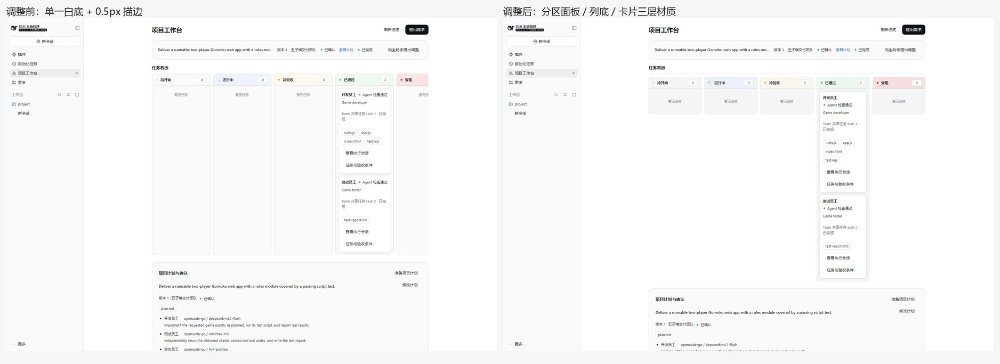
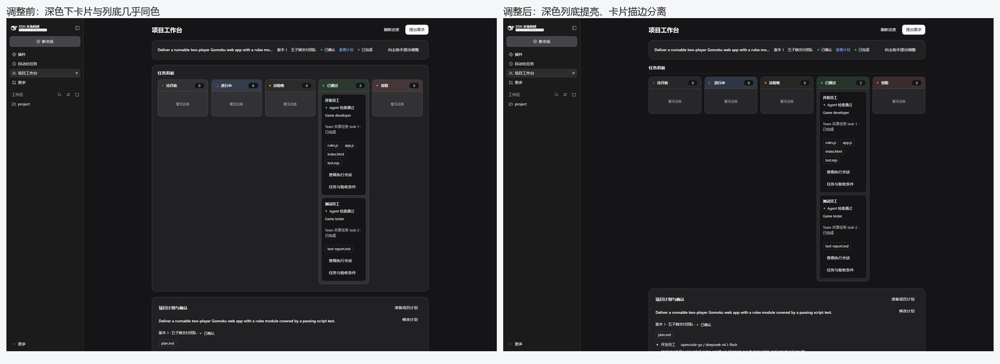

# 工作台视觉层次调整

本页记录项目工作台在任务看板之后的一轮视觉调整：把「白底 + 0.5px 描边」的单层界面改为「分区面板 / 列底 / 卡片」三级材质，并补齐深色与窄屏表现。页面结构见 [项目工作台看板改造对照](22-项目工作台看板改造对照.md)，本轮不改信息组织。

## 为什么会显得单调

DSH 底座并不缺层次 token。浅色主题把 `--dsw-alias-bg-layer-1/2/3` 全部指向 `white`，组件如果只靠这三个 token 叠层，叠多少层都还是纯白；我们的样式此前正是如此，面板、列与卡片都只有 0.5px 描边。

可用的层次来自另外几组 token：

| token | 浅色 | 深色 | 用途 |
|---|---|---|---|
| `--dsw-alias-card-fill` | `#fafafa` | `#212123` | 分区面板填充 |
| `--dsw-alias-bg-skeleton` | 4% 黑叠加 | 8% 白叠加 | 面板内的列底 |
| `--dsw-alias-bg-base` | `#ffffff` | `#151517` | 页面与卡片 |
| `--dsw-elevation-panel` / `-prominent` | 0.5px 描边 + 极淡柔光 | 同左 | 卡片与详情面板 |
| `--dsw-radius-lg` / `-xl` | 16px / 20px | 同左 | 列与面板 |
| `--dsw-alias-state-*-tertiary` | 状态浅色 | 状态浅色 | 列头底色 |

实测结果：浅色下页面 `#ffffff`、面板 `#fafafa`、列底 `#f5f5f5`、卡片 `#ffffff`；深色下页面 `#151517`、面板 `#212123`、列底 `#262628`、卡片 `#2c2c2e`。卡片的 token 在 [看板全屏与卡片材质修正](24-看板全屏与卡片材质修正.md) 中换成了 `bg-layer-2`。

## 改了什么

| 位置 | 调整前 | 调整后 | 目的 |
|---|---|---|---|
| 分区面板（概览、计划、名册） | 0.5px 描边，圆角 12px | `card-fill` 填充 + `radius-xl` + `border-l3` | 三块内容成为同级面板 |
| 看板列 | 无填充，仅描边 | `bg-skeleton` 叠加 + `radius-lg` | 五列各自成块，空列也有边界 |
| 列头 | 纯文字 + 数字 | 状态点 + 状态色底 + 计数徽标 | 列语义与数量一眼可读 |
| 空列 | 空白 | 顶部虚线占位「暂无任务」，最小高度 132px | 不再是整屏空槽 |
| 列高 | 拉伸到最高列 | `align-items: start` | 稀疏数据下按内容收起 |
| 卡片 | 白底 + 0.5px 描边 | `bg-layer-2` + `elevation-panel` | 卡片浮在列底之上 |
| 详情面板 | 白底 + 阴影 | `card-fill` + `elevation-prominent` | 深色下与页面分离 |
| 看板标题 | 悬浮文字 | 标题 + 0.5px 分隔线 | 标记看板区起点 |
| 窄屏 | 列宽固定 180px 起，右侧裁切 | ≤1240px 时列宽 140px 起，`min-width: 0` | 1180px 下五列完整可见 |
| 字号 | 页标题 20px，区块标题 15px/16px 混用 | 22px/600、15px/600 统一 | 标题层级一致 |

所有取值都来自 `--dsw-alias-*`、`--dsw-elevation-*`、`--dsw-radius-*` 与 `--dsw-static-*` 的别名，没有字面色值。

## 前后对照

| 场景 | 图 |
|---|---|
| 浅色工作台 | [首屏](ui-review-20261119/round7/01-board-light.jpeg) |
| 深色工作台 | [深色首屏](ui-review-20261119/round7/02-board-dark.jpeg) |
| 浅色详情面板 | [详情](ui-review-20261119/round7/03-detail-light.jpeg) |
| 深色详情面板 | [深色详情](ui-review-20261119/round7/04-detail-dark.jpeg) |
| 计划与名册 | [下半页](ui-review-20261119/round7/06-roster-light.jpeg) |
| 1180px 窄屏 | [窄屏](ui-review-20261119/round7/06-narrow-1180.jpeg) |

## 窄屏

| 视口 | 内容宽 | 列宽 | 表现 |
|---|---|---|---|
| 1780 | 1004 | 191 | 五列完整，空列占位在列顶 |
| 1180 | 806 | 152 | 五列完整，卡片文字换行两行 |
| 更窄 | — | 140 起 | 看板横向滚动，不裁切到不可见 |

断点 1240px 是按「视口减去侧栏与页边距」反推的：140px × 5 列加间距需要约 748px 内容宽，1180px 视口下有 806px。

## 已知不足

- 深色下卡片一度比列底更深，已在 [看板全屏与卡片材质修正](24-看板全屏与卡片材质修正.md) 中改为 `bg-layer-2`。
- 预览数据只有成功态，受阻、返工、待我处理三种列状态仍无截图。
- 1180px 下「查看执行会话」「任务与验收条件」会换行成两行。
- 看板仍只读，拖放改状态不在本轮范围。

## 检查记录

| 检查 | 结果 |
|---|---|
| `vitest run packages/experimental/client-ui-meeting-room/tests` | 27/27 通过 |
| `vitest run packages/client/ui-theme/tests/color-tokens.client.spec.ts packages/client/ui-theme/tests/elevation-styles.client.spec.ts` | 通过，无字面色值、无描边与阴影混用 |
| `oxlint` | 通过 |
| `verify-client-ui-i18n` | 通过（未新增文案） |
| `build:artifacts`（WSL 预览） | 8 gates 通过 |
| `pnpm run build` | 10 gates 通过 |
| `verify-md-links` | 2641 个文件通过 |
| `test:docs` | 21 gates 通过 |

截图条件与上一轮一致：1780 × 1210，浅色/深色，中文，dpr 1，同一份五子棋项目数据；深色图在页面加载后切换 `data-ds-dark-theme` 再截。
